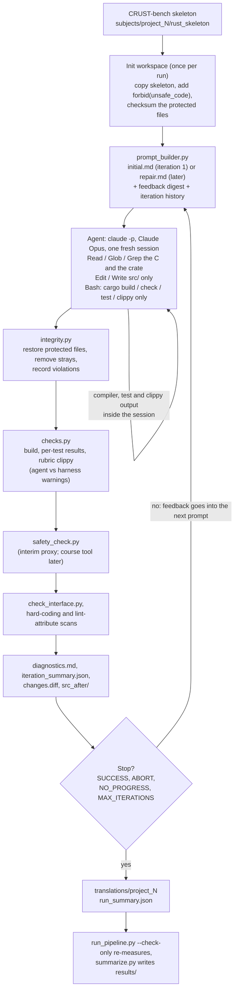

# MP4 — Agentic C-to-Rust translation (Group 1: satc, libpsbt)

Group 1 translates two CRUST-bench projects into safe, idiomatic Rust: `satc` (project_1) and `libpsbt`
(project_2). The translation agent is Claude Code running headless. A Python controller (`src/`) drives it
in a loop: inspect C, write Rust, compile, test, clippy, safety and interface checks, feedback, repair,
repeat until a stopping condition. Results tables are generated from committed artifacts by
`src/summarize.py` into `results/results.md`. Numbers not yet produced are marked PENDING. The only
PENDING numbers are the official unsafe metrics: the course's tool has not been released, so the safety
numbers come from an interim proxy and are labelled as such everywhere.

## Agentic framework and version

[Claude Code](https://docs.anthropic.com/en/docs/claude-code) **2.1.235**, run headless with
`claude -p --output-format stream-json --verbose`. Each iteration starts a fresh session. The controller
(`src/run_pipeline.py`, `src/agent_runner.py`) builds the command line from `configs/pipeline.yaml`,
sends the prompt on stdin, and records the whole event stream as the iteration's trajectory. The agent is
isolated from the machine owner's setup. No user settings, hooks, MCP servers, skills or memory are
loaded (`--setting-sources project`, `--strict-mcp-config`, `--disable-slash-commands`,
`CLAUDE_CODE_DISABLE_CLAUDE_MDS=1`, `CLAUDE_CODE_DISABLE_AUTO_MEMORY=1`). Every call's startup event
is checked. The call is aborted if that event is missing, reports any capability beyond the configured
tools, or shows an API key instead of the subscription login.

## Model(s) and provider / runtime

One model for every iteration, no other agents or models:

| Model | Provider | Access |
|---|---|---|
| Claude Opus, via the `opus` alias (Claude Code reported `claude-opus-5` in our smoke runs) | Anthropic (first party) | Claude Max subscription through Claude Code's own login (`claude auth login`); no API key |

No local model or local runtime is used.

## Inference settings

<!-- BEGIN GENERATED: inference-settings -->
| Setting | Value | Where |
|---|---|---|
| Model | `opus` (alias resolved by Claude Code) | `configs/pipeline.yaml` `agent.model` |
| Effort | `high` | `agent.effort` |
| Max turns per iteration | 60 | `agent.max_turns` |
| Wall clock per iteration | 45 min | `agent.wall_clock_minutes` |
| Budget tripwire | 30 USD (subscription auth; tripwire only) | `agent.max_budget_usd` |
| Permission mode | `dontAsk` | `agent.permission_mode` |
| Max iterations | 8 | `loop.max_iterations` |
| Temperature, top-p, max output tokens | not configurable through Claude Code; provider defaults | - |
<!-- END GENERATED: inference-settings -->

## OS and runtime

Recorded in `docs/environment.md`:

| Component | Version |
|---|---|
| OS | macOS 26.5.2 (build 25F84), Apple Silicon (`arm64`) |
| Rust toolchain | `nightly-2025-05-13`: rustc 1.89.0-nightly (8405332bd 2025-05-12), cargo 1.89.0-nightly, clippy 0.1.88 |
| Controller | Python 3.9.12, standard library plus PyYAML 6.0 |
| Agent | Claude Code 2.1.235 |

## External tools available to the agent

| Tool | Scope |
|---|---|
| `Read`, `Glob`, `Grep` | The crate being translated and the original C project (read-only). Nothing else on the machine. |
| `Edit`, `Write` | The crate only. Writes into the C sources are refused. |
| `Bash` | Only `cargo +nightly-2025-05-13 build`, `check`, `test`, `clippy` and `--version`. Every other command (git, rm, network, dependency changes, shell reads such as `ls` or `cat`) is denied. |
| `StructuredOutput` | The agent's final status (done / needs more work / blocked, files changed, open issues), from `configs/prompts/status_schema.json`. |

The agent has no web access, no git, no subagents, no MCP servers and no skills. The permission mode is
`dontAsk`, so anything not pre-approved is denied without prompting. These rules apply to the agent's tool
calls. The Rust the agent writes is compiled and its tests are run by `cargo`, with the permissions of the
user who runs the controller, so the controller does not rely on the tool rules alone. After every session
it restores the protected benchmark files and re-checks the benchmark sources against their checksums. It
also refuses FFI, `build.rs` and C sources, and every reported number can be re-measured independently
(`--check-only`). The course's unsafe-metrics tool has
not been released yet. Until it is, the controller runs an interim proxy (`src/safety_check.py`) and
feeds its results back to the agent. The agent does not call it directly.

Cross-check against the trajectories: the tool names the agent actually called in both runs are exactly the
seven in the table above, no more and no fewer:

```bash
grep -oh '"name":"[A-Za-z]*"' MP4/trajectories/project_*/run_*/iter_*/agent.stream.jsonl | sort -u
```

## Dependency installation

1. Rust, with the pinned toolchain and clippy:

   ```bash
   curl --proto '=https' --tlsv1.2 -sSf https://sh.rustup.rs -o rustup-init.sh
   sh rustup-init.sh -y --no-modify-path --profile minimal --default-toolchain none
   ~/.cargo/bin/rustup toolchain install nightly-2025-05-13 --profile minimal --component clippy
   export PATH="$HOME/.cargo/bin:$PATH"
   ```

2. Python 3.9 or newer, with PyYAML:

   ```bash
   python3 -m pip install pyyaml
   ```

3. Only to run the agent, not to evaluate the results: Claude Code, logged in with a Claude subscription.

   ```bash
   claude auth login
   claude auth status
   ```

## How to run the pipeline

From the repository root:

```bash
python3 -I MP4/src/run_pipeline.py --project project_1 --dry-run     # print the agent command and first prompt (home paths as ~); no model call
python3 -I MP4/src/run_pipeline.py --project project_1               # full run; asks for confirmation (add --yes to skip)
python3 -I MP4/src/run_pipeline.py --project project_1 --resume-run <run_id>   # continue an interrupted or paused run
```

Use `project_2` for libpsbt. A run first replaces `translations/project_N/` with a fresh copy of the
benchmark skeleton. It writes every iteration to `trajectories/project_N/run_<id>/`, and the final
Rust stays in `translations/project_N/`. Each attempt's exact agent command line, with its session id, is
recorded in that attempt's `agent_result.json`. A resume is refused if the configuration changed since
the run started, or if the CLI is logged out.

**Evaluating without a Claude subscription.** This reruns every measurement (build, tests, rubric
clippy, safety proxy, interface, integrity) on the committed translation without calling a model, and
writes `results/project_N.check.json`:

```bash
python3 -I MP4/src/run_pipeline.py --project project_1 --check-only
python3 -I MP4/src/summarize.py                      # results/results.md and LaTeX table fragments
python3 -I MP4/src/summarize.py --check-report       # the report draft's tables equal the generated ones
python3 -I MP4/src/integrity.py --provenance project_1   # translations/ is the agent's output, unchanged
python3 -I MP4/src/selftest.py                       # the controller's own test suite (no model calls)
```

`summarize.py` refuses to write anything if a number in the run's `run_summary.json` differs from the
`--check-only` re-measurement. It also writes the per-iteration trend tables, the usage-limit digest and
`results/repair_mining.md`, a line-numbered timeline of every cargo call the agent made, with the library
errors and warnings it reported and its test totals, which the report's repair examples cite.

Running the agent itself (`--project` without `--check-only`) needs the Claude Code CLI logged in with a
Claude subscription (`claude auth login`). An interrupted or paused run continues with
`--resume-run <run_id>`; the run id is printed at the start and is the `run_<id>` directory name.

## Pipeline diagram

Source: `docs/pipeline_diagram.mmd` (the report draft carries the same diagram in TikZ).



One agent and one model do all the work. The controller is plain Python: it never writes Rust, it only
measures the crate and turns the measurements into the next prompt.

## Stopping condition

<!-- BEGIN GENERATED: stopping-condition -->
The loop (`MP4/src/run_pipeline.py`) checks after every iteration, in this order:

1. **SUCCESS**: the crate builds with `nightly-2025-05-13`; every benchmark test passes except the documented known-defective ones, and each of those fails on its documented assertion (a benchmark test that hangs, crashes or reports no result counts as failed; tests the agent adds are reported separately and must pass too); clippy runs without errors and agent-attributable clippy warnings are 0 in all four rubric groups; the safety metrics are all 0, `#![forbid(unsafe_code)]` is in place and there is no FFI; every interface item is present and unchanged; no integrity violation; no test literal copied into library code; no lint-level attribute (`allow`, `expect`, `warn`, `deny`, `forbid`, or one inside `cfg_attr`) in library code except the project's permitted `#[allow]`. SUCCESS ends the run from iteration 2 on; a clean crate before that gets a review iteration.
2. **ABORT**: integrity violations (tests, interfaces, `Cargo.toml`/`Cargo.lock` or `src/lib.rs` changed, files created outside `src/`, symlinks) in two consecutive iterations.
3. **NO_PROGRESS**: the score (tests passed, then fewer build errors, clippy warnings, unsafe findings, missing interface items) has not strictly improved for 3 consecutive iterations.
4. **MAX_ITERATIONS**: 8 iterations.

At NO_PROGRESS and MAX_ITERATIONS the best-scoring iteration (a successful one first, then the score above; the later one on a tie) is restored into `translations/` and named in `run_summary.json` `final_iteration_dir`, not the last.

Each iteration is one fresh agent session capped at 60 turns and a 45-minute wall clock. The run also stops if the agent's startup line is missing, shows any capability beyond the configured tools, or shows an API key instead of the subscription login (ABORT_ISOLATION). A usage-limit rejection is not a stop: the run waits until the limit resets (+60 s, at most 6 h) and redoes the iteration (`iter_KK_attemptN`); after 3 refused attempts of one iteration it exits with code 75 for a `--resume-run`. An API outage (overloaded, connection error) is handled the same way with a 60-minute wait. A lost CLI login also pauses: the run exits with code 75 and continues with `--resume-run` after `claude auth login`.
<!-- END GENERATED: stopping-condition -->

## API and usage limits that affected the experiment

**None observed.** No request in either committed run was rejected for a usage limit, and neither run
paused. Every `rate_limit_event` record in the four agent streams reports status `allowed` on the
five-hour window, and both `run_summary.json` files have an empty `usage_limit_pauses` list. The counts
are in the "API and usage limits" table of `results/results.md`, and these commands show them:

```bash
grep -h '"type":"rate_limit_event"' MP4/trajectories/project_*/run_*/iter_*/agent.stream.jsonl | grep -c '"status":"allowed"'
grep -h '"type":"rate_limit_event"' MP4/trajectories/project_*/run_*/iter_*/agent.stream.jsonl | grep -vc '"status":"allowed"'
grep -h '"usage_limit_pauses"' MP4/trajectories/project_*/run_summary.json
```

What the limits did shape was the experiment's size, decided before any run: one full run per project,
at most eight iterations of at most sixty turns each. The per-iteration turns, output tokens and minutes
are in the trend tables of `results/results.md`. Every usage-limit pause, had there been one, would be
recorded in `run_state.json`, `run_summary.json` (`usage_limit_pauses`) and `run.log`.

How limits are handled: the subscription has rolling 5-hour and weekly limits. A rejected request is
detected from the event stream. The run then waits until the reported reset time, or exits with code 75
for a later `--resume-run`, and repeats the interrupted iteration as a new attempt. After three refused
attempts of the same iteration it always exits with code 75, so a person decides when to go on. Each iteration is
capped at the turn limit and wall clock in the table above. The experiment budget is fixed in advance at
one full run per project plus at most two tuning reruns, and the controller refuses runs beyond it.

## Models, frameworks and tools used

| Item | Version / identifier | Role |
|---|---|---|
| Claude Code | 2.1.235 | Agent framework, headless |
| Claude Opus (`opus` alias) | reported as `claude-opus-5` | The only model |
| Rust toolchain | nightly-2025-05-13 (rustc 1.89.0-nightly) | Build, test, used by the agent and the controller |
| Clippy | 0.1.88 | Idiomaticity feedback and scoring (correctness, style, complexity, perf) |
| Python + PyYAML | 3.9.12, 6.0 | Controller (`src/`) |
| Safety proxy | `src/safety_check.py` (`proxy-1`) | Interim unsafe metrics until the course tool is released |
| CRUST-bench | commit `4b47025`, `datasets/CRUST_bench.zip` | Source of the C projects, Rust interfaces and tests |

## Repository layout

```
MP4/
├── README.md
├── src/            controller: run_pipeline.py (loop, CLI), agent_runner.py, prompt_builder.py, checks.py,
│                   safety_check.py, check_interface.py, integrity.py, scrub_secrets.py, summarize.py,
│                   config.py, selftest.py (+ selftest_fixture/, fake_agent.py, tests/)
├── configs/        pipeline.yaml, claude_settings.json, agent_system_prompt.md, prompts/, projects/,
│                   cheatsheet_c_to_rust.md, CHANGELOG.md (every config change, with its evidence)
├── trajectories/   project_1/, project_2/: baseline/, run_<id>/iter_KK/..., run_summary.json, INDEX.md
├── translations/   project_1/, project_2/: the final generated Rust crates
├── subjects/       project_1/, project_2/: original C (c/) and CRUST-bench Rust skeleton (rust_skeleton/),
│                   with CHECKSUMS.sha256 and SOURCE.md
├── results/        check.json per project, results.md, LaTeX table fragments, repair_mining.md (generated)
└── docs/           environment.md, rubric_traceability.md, pipeline_diagram.mmd,
                    report_mp4_draft.md and .tex (the MP4 section of the progress report)
```

## Infrastructure interventions

No translated function was repaired by hand. Everything under `translations/` is produced by the
agent, and `src/integrity.py --provenance` checks that it is byte-identical to the snapshot of the
iteration the run shipped (`run_summary.json` `final_iteration_dir`). The controller performs these documented interventions:

- **`#![forbid(unsafe_code)]` injection.** When a run starts, the controller writes this line at the top
  of each crate's `src/lib.rs`, before the agent's first turn, so unsafe code cannot compile. Program
  logic affected: no.
- **Restoring protected files.** If the agent changes a test file, an interface file, `Cargo.toml`,
  `Cargo.lock` or `src/lib.rs`, the controller restores it after the iteration and records an integrity
  violation. That iteration cannot count as a success. The same applies to a hand edit of the crate
  between iterations, or while a run waits on a pause, which is reverted. Program logic affected: no (only
  immutable benchmark files and unauthorised edits are reverted).
- **Removing files the agent may not create.** Any file the agent leaves outside `src/` that the benchmark
  skeleton does not have (for example `.cargo/config.toml`, `clippy.toml`, `build.rs`, `tests/`), any
  symlink, and any extra file under `.integrity/` is deleted and recorded as an integrity violation. The
  check runs before the build and again after the controller's own measurement, because the agent's unit
  tests run during that measurement and could plant such a file. Program logic affected: no (none of these
  files is library code; the library is `src/`).
- **Shipping the best iteration.** When a run stops at MAX_ITERATIONS or NO_PROGRESS without a successful
  iteration, the controller copies the best iteration's own `src/` snapshot back into `translations/` (see
  "Stopping condition"); provenance then checks against that snapshot. Program logic affected: no (it is
  the agent's output from that iteration, unchanged). Neither committed run needed it: both stopped at
  SUCCESS.
- **Known-defective benchmark test (libpsbt `read_test_vector`).** The test's callback re-declares its
  step counter on every call, so it asserts that every record is of type 0, while the test vector
  contains records of other types. A faithful parser fails this test. The controller excludes it from the
  success condition, but only when it fails on exactly the documented assertion. It is still run and
  reported in every result, and the agent is told never to suppress callbacks to make it pass. A ruling
  from the course staff is pending. Program logic affected: no.
- **C behaviour rulings.** Where the C has bugs that the tests do not exercise, the agent is told to
  reproduce them exactly when the C is well defined, and to choose defined, non-panicking behaviour when
  it is undefined. The cases are listed in `configs/projects/*.yaml`. One clippy suppression is
  permitted: `too_many_arguments` on satc's fixed 8-parameter `satc_is_separating_axis` signature.
  Program logic affected: no (these are instructions the agent received before it wrote any code; no
  code was changed afterwards).
- **libpsbt `psbt_geterr` keeps the benchmark's pre-filled body.** The interface file ships
  `psbt_geterr()` already implemented, returning the constant `PSBT_ERRMSG` ("psbt error"). Our project
  note told the agent to keep the behaviour of pre-filled interface bodies, so it did. The C returns the
  last error message instead, so the Rust CLI prints "psbt error" where the C prints the specific
  message. The translation still records each message internally, the way the C assigns
  `psbt_errmsg`. This is a deliberate reading of a pre-filled interface body, not a repair. Program logic
  affected: no.
- **Scrubbing the trajectories.** As trajectory files are written, the controller replaces the home
  directory with `~` and removes anything that looks like an API key, token or e-mail address
  (`src/scrub_secrets.py`). `scrub_secrets.py --check MP4/` reports 0 hits on the committed tree. Program
  logic affected: no (only the logs are rewritten, never the crate).
- **Tool-policy change before the first run.** On 2026-10-29 the agent's tool permissions were tightened
  after a smoke test showed it could read files outside its directories (`configs/CHANGELOG.md`). No
  translation run had happened yet. Program logic affected: no.

## Academic integrity

All Rust under `translations/` was written by the agent described above, inside the logged sessions in
`trajectories/`. No person edited a translated function, and `src/integrity.py --provenance` checks this
against the snapshots in the trajectories. The controller in `src/`, the configurations and prompts in
`configs/` and this README were written by the team with the help of an AI coding assistant, and are our
own work for this course. The benchmark C code, Rust interfaces and tests come unchanged from
CRUST-bench (see `subjects/*/SOURCE.md`). The prompts contain no function implementations and no
expected test outputs.
